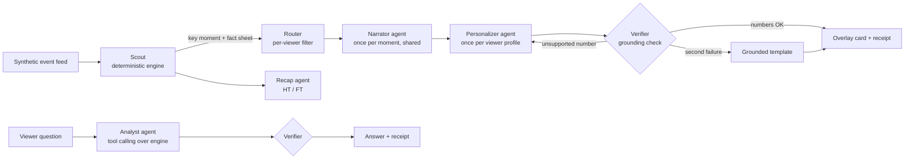

# MatchItUp ⚽ — every match, made for every fan

**MatchItUp turns a live feed of synthetic football events into explainable match intelligence: real-time stats, AI-written "why it matters" narratives, broadcast-ready overlays and automated recaps — personalised for each viewer by mode, language, favourite club and favourite player.**

Built for the *Inside the Game: Developer Hackathon* (Microsoft × Premier League).
All data is **100% synthetic**: clubs, players and the venue are fictional.

---

## The problem

Live football coverage gives every viewer the same graphics. A data-hungry analyst wants pass difficulty and momentum; a casual fan wants to know *why* the crowd just got louder — in their own language, from their own club's point of view. Producing that by hand for every audience is impossible at broadcast speed.

## What MatchItUp does

One pipeline, five stages, exactly as the brief describes:

| Stage | What happens | Where |
|---|---|---|
| **1. Ingest** | Synthetic match events (passes, shots, tackles, pressures, possession changes, tracking samples, match metadata) are replayed as a live feed. | `matchitup/generator.py`, `app/main.py` |
| **2. Interpret** | A deterministic engine computes possession, pass accuracy, a **pass difficulty rating**, pass distance, **ball & shot speed**, xG, momentum, game rhythm (control vs chaos), pressing and player distance/top speed — and detects key moments. | `matchitup/engine.py` |
| **3. Explain** | The **Narrator agent** (Microsoft Foundry model) explains *why* each moment matters — control vs chaos, pressure shifts, rhythm, chance quality — citing numbered facts. | `matchitup/agents/narrator.py` |
| **4. Render** | Timed, machine-readable overlay cards (lower third, top-right, player tag, full banner) sit on a live pitch view; the same cards are exposed as an overlay JSON timeline for a rendering partner. | `app/static/`, `GET /api/overlays` |
| **5. Personalise** | The **Personalizer agent** rewrites each insight for the viewer: *Analyst*, *Casual fan* or *Player focus* mode, any language (English and Hindi work even offline), favourite club framing ("your team" / "danger") and a focus metric. | `matchitup/agents/personalizer.py` |

Plus: an **automated half-time and full-time recap**, and an **Ask the Analyst** box where viewers ask questions and a tool-calling agent answers from live stats.

## Agentic design



| Agent | Type | Job |
|---|---|---|
| **Scout** | Deterministic code | Computes every number and detects 14 kinds of key moment, each with a numbered fact sheet and evidence event IDs. |
| **Router** | Deterministic code | Decides which moments each viewer receives (mode, favourite player, focus metric). |
| **Narrator** | LLM (Foundry) | Neutral explanation of *why it matters*, run **once per moment** and shared by all viewers. |
| **Personalizer** | LLM (Foundry) | Per-profile card in the viewer's language and voice. **Reflection loop:** if the Verifier rejects it, the agent retries once with the reason, then falls back to a template. |
| **Verifier** | Deterministic guardrail | Every number in generated text must exist in the fact sheet (handles Devanagari and Arabic digits). |
| **Recap** | LLM (Foundry) | Studio-ready HT/FT recap from the snapshot and key moments, verified. |
| **Analyst** | LLM with tool calling | Answers viewer questions by calling read-only tools (`get_match_summary`, `get_team_stats`, `get_player_stats`, `get_top_players`, `get_recent_moments`), max 4 calls, refuses out-of-scope questions. |

**Design principles**

- **The model is never the source of numbers.** Deterministic code computes; AI explains. This keeps answers fast, testable and free of invented statistics.
- **Explain once, personalise many.** The expensive explanation is cached per moment; only the short card is generated per viewer profile, so cost grows slowly with audience size.
- **Every card carries its receipt:** source (model or template), model name, tokens, latency per agent step, "✓ grounded · N numbers checked", the fact sheet and the evidence event IDs.
- **Graceful degradation.** With no model, a timeout, or a failed check, the viewer still gets a correct, grounded card from templates. The live show never stops.

## Microsoft technologies

| Technology | How it is used |
|---|---|
| **Microsoft Foundry (Azure OpenAI)** | Narrator, Personalizer, Recap and Analyst agents (`LLM_PROVIDER=azure`). |
| **Microsoft Entra ID / managed identity** | Keyless auth from the app to Foundry (`DefaultAzureCredential`); no API keys in code or config. |
| **Azure Container Apps** | Hosting with HTTP autoscaling and revisions (`infra/deploy-aca.sh`). |
| **Azure Monitor Application Insights + OpenTelemetry** | Each agent step is exported as a span when a connection string is set. |
| **GitHub Models** | Free model endpoint for local development (`LLM_PROVIDER=github`). |
| **GitHub Codespaces, Actions, Copilot** | One-click dev environment (`.devcontainer`), CI test run on every push, Copilot extension preinstalled. |

## Quick start

### Option 1 — GitHub Codespaces (nothing to install)
1. On the repository page click **Code → Codespaces → Create codespace on main**.
2. In the terminal run:
   ```bash
   uvicorn app.main:app --reload
   ```
3. Open the forwarded port **8000**. Click **Kick off**.

### Option 2 — your computer
```bash
python -m venv .venv && source .venv/bin/activate   # Windows: .venv\Scripts\activate
pip install -r requirements-dev.txt
uvicorn app.main:app --reload
# open http://localhost:8000
```

It runs immediately in **template mode**. To switch on the AI agents, copy `.env.example` to `.env` and set either the Foundry (Azure OpenAI) or GitHub Models values, then restart.

### Run the tests
```bash
pytest -q
```
The suite covers the generator, engine metrics, the Verifier, the agent pipeline (with a scripted fake model, including the retry and fallback paths), the Analyst tool loop and the HTTP API, including the live stream.

### Deploy to Azure
```bash
az login
bash infra/deploy-aca.sh
```
Creates a Foundry resource with a model deployment, Application Insights and an Azure Container App with a managed identity, then prints the public URL.

## Try these in the demo

- **Compare view** (`/compare`): the same match side by side for an English analyst and a casual Northgate fan watching in Hindi.
- **Player focus**: pick *Aarav Kapoor* and watch a player card every 15 minutes plus every moment he is involved in.
- **Focus metric → Speed**: only sprints and shot-speed moments.
- **Ask**: "Who is the fastest player?", "How is Northgate pressing?", "What's the weather?" (out of scope).
- Open any card's receipt to see the agent steps, the facts and the evidence IDs.

## API

| Endpoint | Purpose |
|---|---|
| `GET /api/stream` | Live Server-Sent Events: event frames, stats snapshots, insight cards, recaps. Params: `mode`, `language`, `favourite_club`, `favourite_player`, `focus_metric`, `speed`, `start_minute`, `seed`. |
| `GET /api/overlays` | Whole-match overlay timeline (`matchitup.overlay.v1`) for a rendering partner. `ai=true` uses the model. |
| `POST /api/ask` | Ask the Analyst agent: `{question, t, mode, language}`. |
| `GET /api/recap` | Full-time recap for a profile. |
| `GET /api/events` | The synthetic event feed as JSON Lines. |
| `GET /api/match`, `GET /api/health` | Match metadata; service, model and telemetry status. |
| `GET /docs` | Interactive OpenAPI documentation. |

## Synthetic data

`python -m matchitup.generator --seed 8 --out data/match_seed8.jsonl` writes a full 90-minute match (~2,800 events).

- Two fictional clubs (Riverside Rovers, Northgate Athletic) with distinct styles (possession vs pressing) and 22 fictional players with **stable IDs** (`RIV-07`) separate from display names.
- A hidden, drifting "dominance" value per team produces realistic spells of control, chaos and momentum swings.
- The generator emits only *observable* facts (locations, outcomes, ball speed, tracking samples). Derived metrics are computed independently by the engine, the same way a real pipeline would.
- Calibrated to football-realistic ranges (≈950 passes, ≈77% completion, ≈20–25 shots). Any seed produces a new match; seed 8 is a 2–2 thriller.

Event example:
```json
{"event_id": "E01234", "t": 1834.2, "period": 1, "minute": 30, "second": 34, "type": "pass",
 "team_id": "RIV", "player_id": "RIV-08", "receiver_id": "RIV-09", "start": [42.1, 30.5],
 "end": [68.0, 22.3], "outcome": "complete", "under_pressure": true, "height": "ground", "ball_speed_kmh": 61.2}
```

## Project structure

```
matchitup/
  generator.py        synthetic match generator (stage 1 data)
  engine.py           deterministic stats + key-moment detection (stage 2)
  llm.py              Foundry / GitHub Models client with receipts
  templates.py        grounded fallback narratives (English, Hindi)
  telemetry.py        agent step timing + OpenTelemetry export
  agents/
    narrator.py       why-it-matters explanations (stage 3)
    personalizer.py   per-viewer cards with reflection retry (stage 5)
    verifier.py       grounding guardrail
    recap.py          automated HT/FT recaps
    analyst.py        tool-calling Q&A agent
    orchestrator.py   routing, caching, overlay cards
app/
  main.py             FastAPI: live SSE stream, APIs (stages 1 and 4)
  static/             broadcast-style web UI and compare view
infra/deploy-aca.sh   Azure deployment (Foundry + Container Apps + App Insights)
tests/                pytest suite
docs/                 architecture, setup guide, demo script
```

## Responsible AI

- Numbers are computed by code, never by the model; every generated number is checked before display.
- Templates guarantee a correct answer if the model fails or is unavailable.
- The Analyst agent refuses questions outside the match.
- No real players, clubs or match data are used, and no personal data is collected or stored.

## Roadmap

- **Auto-eventing from video:** replace the synthetic feed with a vision model that tags passes and speeds from an incoming video feed (the engine and agents are unchanged because they consume the same event schema).
- Voice commentary with Azure AI Speech in the viewer's language.
- Microsoft Fabric eventstream for multi-match ingestion.

## License

MIT — see `LICENSE`. Synthetic data generated by this project may be reused freely.
